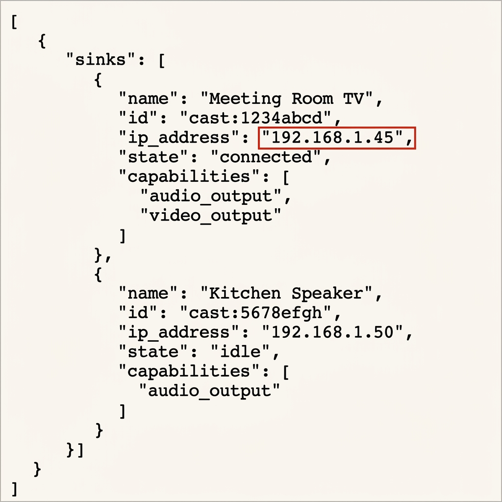

# Edge Media Router Internals (`edge://media-router-internals/`)

## Overview
The internal diagnostic page `edge://media-router-internals/` provides a raw JSON data dump containing real-time configurations, discovery statistics, and troubleshooting logs for Microsoft Edge's **Media Router** component. 

The Media Router is the browser subsystem responsible for casting tabs, mirroring screens, and streaming audio/video to external receivers (such as Chromecasts, smart TVs, and wireless displays).

### Key Features
* **Device Discovery Diagnostics (Sinks):** Lists all discovered casting targets on the local network in a raw JSON array.
* **Active Casting Sessions (Routes):** Shows current active streams, connection paths, and session statistics.
* **Diagnostic Log Stream:** Displays a running plain-text log of internal media router events and connection warnings.

## Prerequisites
* **OS Support:** Windows 10 / 11 / macOS / Linux
* **Browser:** Microsoft Edge (or Google Chrome via `chrome://media-router-internals/`)
* **Network:** Client device must be on the same local subnet/Wi-Fi network as the cast receivers (e.g. Chromecast, Apple TV, Smart TV).

## Walkthrough & Troubleshooting Guide

### 1. Accessing the Diagnostics Page
1. Open Microsoft Edge.
2. In the address bar, type or paste:
   ```text
   edge://media-router-internals/
   ```
3. Press **Enter**. The browser will display a raw text/JSON diagnostic output page containing the current media router status.

### 2. Common Diagnostics Scenarios

#### Troubleshooting Missing Cast Devices (Sink Discovery)
If a Smart TV or Chromecast is not appearing when you click "Cast" in the browser:
1. Load `edge://media-router-internals/`.
2. Look through the JSON array under the `"sinks"` section to verify if the browser is detecting any casting targets.
3. If the sinks array is empty, verify that:
   * **mDNS / SSDP Multicast** is allowed on your network router or firewall.
   * Your machine is on the same subnet as the target display.
   * "Media Router" flags are enabled in `edge://flags`.

#### Analyzing Connection Failures and Disconnections
If casting starts but immediately drops, lags, or buffers:
1. Keep the `edge://media-router-internals/` tab open in a separate tab while attempting to cast.
2. Observe the JSON properties in the `"routes"` (active sessions) section to watch connection statuses.
3. Check the `"logs"` section at the bottom for handshake failures, buffer underflows, or network timeout warnings.

### 3. Retrieving Device IP Addresses (Why It's Useful)
In the raw JSON dump under the `"sinks"` key, you will see a detailed configuration block for each detected cast receiver. This block includes the device's **local IP address** (often listed under keys like `"ip_address"`, `"address"`, or as part of a socket string).

Capturing this IP address is extremely handy for IT administrators and network technicians to:
* **Verify Subnet Alignment:** Confirm if the casting device is on the same VLAN/subnet as the client.
* **Perform Ping Connectivity Tests:** Run `ping [device-ip]` from the command line to verify basic ICMP packet response and latency.
* **Access Device Admin Pages:** Some smart TVs and casting devices host local web administrators or API configuration panels at their IP addresses.
* **Examine Firewall Policies:** Check if local routers or switches are blocking port `8008` (Google Cast), `1900` (UPnP/SSDP), or `5353` (mDNS) by tracing traffic targeting the device's IP.

Below is a mockup demonstrating how Edge displays the raw JSON output and highlights where to locate the IP address:


