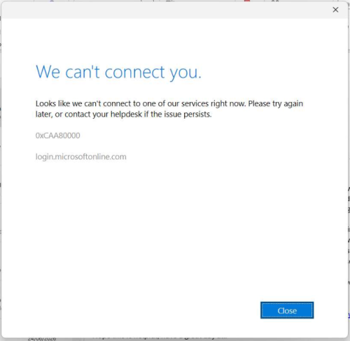

# Hard Reset Windows Internet Settings

## Overview
Even though Internet Explorer is officially retired, Windows still uses the core Internet Properties engine (`inetcpl.cpl`) to manage system-wide proxy configurations, SSL states, and default internet behaviors. 

This guide explains how to use a direct system command to forcefully reset these settings. This is highly effective for fixing stubborn "No Internet" connection bugs, clearing stuck proxy servers (often left behind by malware or VPNs), and resolving Office 365 activation/sign-in issues.

### Known Errors Fixed
This reset is specifically known to resolve Microsoft 365 modern authentication and login failures, including:
* **"We can't connect you."** 
* **"Looks like we can't connect to one of our services right now."**
* **Error Codes:** `0xCAA80000`, `CAA80000`, `CAA800000`



## Prerequisites
* **Access/Permissions:** Standard User (Local Admin is helpful if system-wide proxy settings are locked, but not strictly required for user-level resets).
* **Required Tools:** Windows Run Dialog (`Win + R`)
* **Target Audience:** L1 Techs, Helpdesk Engineers

## Step-by-Step Guide

### 1. Open the Run Dialog
Press the **Windows Key + R** on your keyboard to open the Run window.

### 2. Execute the Reset Command
In the Run box, type or copy/paste the following exact command:

```cmd
RunDll32.exe InetCpl.cpl,ResetIEtoDefaults
```

Press **Enter** or click **OK**.

### 3. Confirm the Reset
A "Reset Internet Explorer Settings" dialog box will immediately appear on the screen. 
1. Tick the checkbox that says **Delete personal settings**. 
   > [!NOTE] 
   > Ticking this box is crucial. It ensures that all corrupted temporary internet files, stubborn cookies, broken cached proxy scripts, and invalid web form data are entirely wiped out.
2. Click the **Reset** button at the bottom of the window.

### 4. Finalize and Restart
1. The window will process the reset. Wait for all items to display a green checkmark.
2. Click **Close**.
3. **Close and reopen the Microsoft program you are struggling with** (e.g. Outlook, Teams, Word).
4. **Note:** In some cases, if the issue persists, a full system reboot is required to completely flush the DNS and apply the new internet state globally.

## Troubleshooting
> [!WARNING]
> **Common Issue:** The dialog box doesn't appear when executing the command.
> **Solution:** The system may have a Group Policy or AppLocker rule preventing the execution of `RunDll32.exe`. Try opening an elevated Command Prompt (Run as Administrator) and executing the command directly from the CLI.

## Related Resources
* [Fixing Office 365 Activation Issues](https://learn.microsoft.com/en-us/microsoft-365/troubleshoot/administration/office-365-activation-issues)
