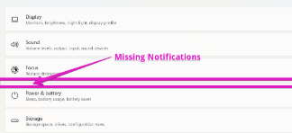

# Fix Missing Notifications Settings Bar in Windows 11



## Overview

In Windows 11, IT administrators or users may encounter an issue where the **System > Notifications** section completely disappears from the Settings app. The options menu jumps directly from *Focus* to *Power & battery*, leaving users unable to configure app notification toasts, quiet hours, or notification banners.

This guide explains why this policy conflict happens on Intune-managed endpoints and provides step-by-step instructions for temporary endpoint verification and permanent remediation in Microsoft Intune.

---

## Prerequisites

* **Access / Permissions:** 
  * Local Administrator privileges (for local PowerShell verification)
  * Intune Administrator or Global Administrator role (for tenant-wide policy remediation)
* **Required Tools:** 
  * Windows PowerShell 5.1+ or PowerShell 7+
  * Microsoft Intune Admin Center (`https://intune.microsoft.com`)
* **Target Audience:** L1/L2 Desktop Support Engineers, Endpoint Systems Administrators

---

## Step-by-Step Guide

### 1. Confirm Root Cause via PowerShell

Open PowerShell (as Administrator to bypass execution policy restrictions) and query the local MDM Policy Manager registry key for hidden settings pages:

```powershell
# Query local MDM Policy Manager for hidden Settings pages
Get-ItemProperty -Path "HKLM:\SOFTWARE\Microsoft\PolicyManager\current\device\Settings" -Name "PageVisibilityList"
```

#### The Smoking Gun
If the returned `PageVisibilityList` string contains `quietmomentsgame;`, Windows 11 completely suppresses the parent **System > Notifications** node in the Settings UI:

```text
hide:gaming-gamebar;gaming-gamedvr;gaming-broadcasting;gaming-gamemode;gaming-trueplay;gaming-xboxnetworking;quietmomentsgame;
```

> [!IMPORTANT]
> **Why This Happens:**  
> When a Microsoft Intune **Device Restriction** profile sets *Gaming* to **Block**, Microsoft automatically appends `quietmomentsgame;` to the OMA-URI payload alongside all `gaming-*` URIs.
> 
> In legacy Windows 10 builds, *Quiet Moments* (Focus Assist) was a separate settings page under Gaming. In Windows 11, Microsoft merged focus and quiet hours directly into **Settings > System > Notifications**. Consequently, hiding `quietmomentsgame` unexpectedly breaks the entire parent Notifications menu.

---

### 2. Quick Local Verification & Temporary Fix

To instantly verify the fix on a local machine before modifying global Intune profiles:

1. Open **PowerShell** as Administrator.
2. Strip `quietmomentsgame;` out of the registry value and restart `explorer.exe`:

```powershell
# Update PageVisibilityList to omit quietmomentsgame
$newValue = "hide:gaming-gamebar;gaming-gamedvr;gaming-broadcasting;gaming-gamemode;gaming-trueplay;gaming-xboxnetworking;"
Set-ItemProperty -Path "HKLM:\SOFTWARE\Microsoft\PolicyManager\current\device\Settings" -Name "PageVisibilityList" -Value $newValue

# Restart Explorer and Settings
Stop-Process -Name explorer -Force
```

3. Reopen **Settings > System**: the **Notifications** menu will immediately reappear.

> [!WARNING]
> This local registry edit is temporary. On the next Intune MDM sync evaluation cycle, Intune will re-apply the policy and overwrite the registry key. Follow Step 3 for permanent tenant remediation.

---

### 3. Permanent Remediation in Microsoft Intune

To permanently restore the Notifications tab across all managed endpoints without unblocking gaming features:

#### Sub-step A: Update the Existing Device Restriction Profile
1. Log into the **[Microsoft Intune Admin Center](https://intune.microsoft.com)**.
2. Navigate to **Devices > Configuration Profiles**.
3. Locate the profile containing **Device Restrictions**.
4. Edit **Configuration Settings** and change **Gaming** from **Block** to **Not Configured**.
5. Save and deploy the updated profile.

#### Sub-step B: Deploy Custom Replacement OMA-URI Policy (If Gaming Must Remain Blocked)
If your organization requires gaming features to remain hidden, deploy a targeted Custom OMA-URI profile that excludes `quietmomentsgame`:

1. In Intune, go to **Devices > Configuration Profiles > Create Profile**.
2. Select Platform: **Windows 10 and later**.
3. Select Profile Type: **Templates > Custom**.
4. Click **Create** and enter a name (e.g. `Win11 - Hide Gaming Pages (Excluding Notifications)`).
5. Under **OMA-URI Settings**, add a new setting:

| Parameter | Value |
| :--- | :--- |
| **Name** | Hide Gaming Pages (Safe for Windows 11) |
| **OMA-URI** | `./Device/Vendor/MSFT/Policy/Config/Settings/PageVisibilityList` |
| **Data Type** | `String` |
| **Value** | `hide:gaming-gamebar;gaming-gamedvr;gaming-broadcasting;gaming-gamemode;gaming-trueplay;gaming-xboxnetworking;` |

> [!TIP]
> Notice that `quietmomentsgame;` is omitted from the end of the `Value` string. This effectively hides all Xbox and Gaming setting pages while preserving full access to **Settings > System > Notifications**.

6. Assign the custom profile to your target Windows 11 Device Groups and save.

---

## Troubleshooting

> [!CAUTION]
> **Issue:** The Notifications menu disappeared again after a reboot or sync.  
> **Cause:** The machine re-synced with Intune and re-applied the original Device Restriction profile containing `quietmomentsgame`.  
> **Solution:** Ensure Sub-step A (setting Gaming to *Not Configured* in Device Restrictions) is saved and synced on the endpoint via **Settings > Accounts > Access work or school > Info > Sync**.

---

## Related Resources

* [Microsoft Learn: Policy CSP - Settings / PageVisibilityList](https://learn.microsoft.com/en-us/windows/client-management/mdm/policy-csp-settings#pagevisibilitylist)
* [Microsoft Learn: Intune Device Restrictions for Windows 10/11](https://learn.microsoft.com/en-us/mem/intune/configuration/device-restrictions-windows-10)
